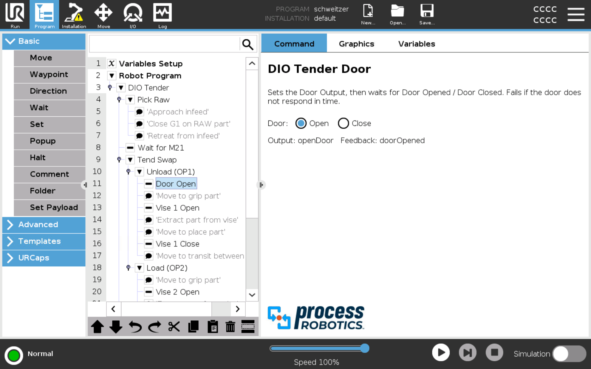
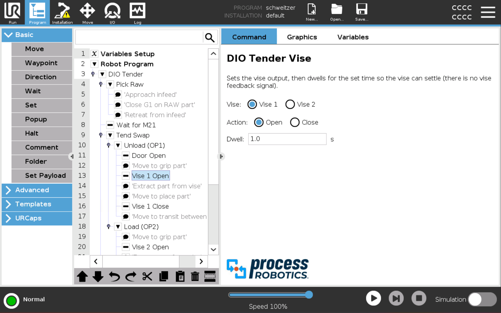

  

# DIO Tender

A URCap for Universal Robots e-Series that gives you a ready-made program skeleton for **machine tending** with a dual-gripper, dual-vise setup. You map your machine's signals once, then teach only the robot moves.

## Features

- **Ready-made cycle**: Pick Raw → Wait for M21 → Tend Swap (Unload, Load) → Place Finished, repeated forever.
- **Signal mapping**: connect the machine, vises and door to digital I/O or Modbus signals, with optional inversion.
- **Door and Vise nodes**: open or close the door (with feedback and timeout) or a vise (with a settle dwell).
- **Automatic handshake**: a short Cycle Complete pulse is never missed, and Cycle Start is pulsed once the robot is clear and the door is closed.

## Requirements

- Universal Robots e-Series.
- A machine, vises and door controllable through digital I/O or Modbus signals.

## Setup

### 1. Install the URCap

Copy the `.urcap` file to the robot and restart PolyScope, following the usual UR procedure for installing a URCap.

### 2. (Modbus only) Define your signals

Add any Modbus signals in **Installation > Fieldbus > MODBUS** first and give each a clear name. 0 means off, above 0 means on.

### 3. Map the seven signals

Open **Installation > URCaps > DIO Tender**, tick **Enable**, and choose an I/O for every signal.

| Signal | Direction | Purpose |
|--------|-----------|---------|
| Cycle Complete | machine → robot | Machine finished; robot may tend it |
| Door Opened | door → robot | Door fully open |
| Door Closed | door → robot | Door fully closed |
| Cycle Start | robot → machine | Pulse telling the machine to begin a cycle |
| Vise 1 | robot → vise | Open / close vise 1 |
| Vise 2 | robot → vise | Open / close vise 2 |
| Door Output | robot → door | Open / close the door |

Tick **Invert** if a signal's logic is reversed. The buttons next to each output let you test it immediately.

> [!NOTE]
> DIO Tender program nodes stay undefined until it is enabled and all seven signals are mapped.

## Using it in a program

1. In the **Program** tab, open **URCaps** and insert **DIO Tender**. It creates the template tree with comments describing what to teach at each step.
2. Teach your moves inside **Pick Raw**, **Unload (OP1)**, **Load (OP2)** and **Place Finished**.
3. Add **DIO Tender Door** and **DIO Tender Vise** nodes inside Unload and Load where needed.

### The cycle

| Node | What it does |
|------|--------------|
| **Pick Raw** | Your moves to pick a raw part from the infeed. |
| **Wait for M21** | Pauses until the machine signals Cycle Complete. |
| **Tend Swap** | Fixed container holding **Unload (OP1)** and **Load (OP2)**. When both finish, Cycle Start is pulsed. |
| **Place Finished** | Your moves to place the finished part at the outfeed. |

### Door node

Choose **Open** or **Close**. The node sets the Door Output, waits for the matching feedback, and stops with an error popup if the door doesn't respond within 10 seconds.

### Vise node

Choose the vise, **Open** or **Close**, and a **Dwell** time (default 1.0 s, max 60 s). Vises have no feedback signal, so the dwell lets them settle.

> [!IMPORTANT]
> Both grippers must be empty when the program starts.

## Safety I/O integration

DIO Tender only uses **standard (non-safety) digital I/O and Modbus signals**. The Door Opened / Door Closed feedback, Door Output and Cycle handshake are **not safety functions** and must not be relied on to protect people. Wire machine and cell safety separately through the robot's safety I/O.

References: UR5e User Manual (SW 5.26) section 8.6 *Safety I/O*, and PolyScope e-Series Software Handbook (SW 5.26) section 2.7 *Safety I/O* (the handbook's 2.6 *Software Safety Limits* and 2.8 *Software Safety Restrictions* cover limits and safety planes).

### Key points

- **Redundant, dual-channel.** All safety I/O are paired (Category 3, PLd). Keep the two channels as separate branches.
- **Permanent inputs** (yellow/red terminals): *Robot Emergency Stop* (E-stop equipment only) and *Safeguard Stop* (protective devices such as door switches, light curtains, mats and scanners).
- **Configurable I/O** (CI/CO, yellow/black terminals) can be assigned safety functions in **Installation > Safety > I/O**. These are separate from the general-purpose digital I/O that DIO Tender maps.
- **Safety configuration is locked by a checksum.** Changing it powers the robot off and requires applying and confirming the new configuration. Test all safety functions after any change and regularly afterwards.

### Typical machine-tending connections

| Need | Use | Notes |
|------|-----|-------|
| Machine door interlock | **Safeguard Stop** (SI0/SI1) | Stop Category 2, protective stop. Drive power stays on, program pauses and resumes. |
| Reset after guard is cleared | **Safeguard Reset** (CI pair) | Two-channel reset button placed outside the cell. Required for light curtains. |
| Share E-stop with the machine | **External Emergency Stop** (input pair) and **System Stop** (output pair) | Do not use the Robot Emergency Stop input for sharing. Use a safety PLC if more than two machines are linked. |
| Slower motion while operator is near | **Reduced** input | Low signal switches to the Reduced configuration. Limits are met in under 0.5 s. |
| Tell the machine the robot is stopped or moving | Safety outputs such as **Robot Moving**, **Robot Not Stopping**, **Not Reduced**, **Safe Home** | All safety outputs go low on a fault. |
| Manual / Automatic switching | **Operational Mode** input | Key switch with redundant layout or safety PLC. Low is Automatic, high is Manual. |

### Notes for this URCap

- Keep the **Door Output** (open/close) on general I/O, and the **door lock/interlock switch** on Safeguard Stop. The door being closed in software does not make the cell safe.
- If the Safeguard Stop trips mid-cycle, the program pauses and the Door and Vise nodes resume where they left off. Check that an interrupted door or vise move is safe to resume, since vises have no feedback signal.
- Do not use automatic Safeguard Reset where a person can re-trigger the signal from inside the perimeter. Use an external reset outside the cell.
- Safety outputs may be set to emit **OSSD test pulses** (1 ms low pulse every 32 ms). Make sure the machine input accepts them, or leave OSSD disabled.
- Inputs are filtered to tolerate OSSD pulses under 3 ms.
- Any machine receiving the E-stop state from the robot's **System Stop** output must comply with ISO 13850. It needs a manual action to resume once the E-stop is released.
- Use **Safe Home** or **Not Reduced** outputs only for signalling to the machine. DIO Tender's Wait for M21 and Cycle Start do not replace them.

> [!WARNING]
> Perform a risk assessment for the complete cell. Verify and test every safety function before production use.
