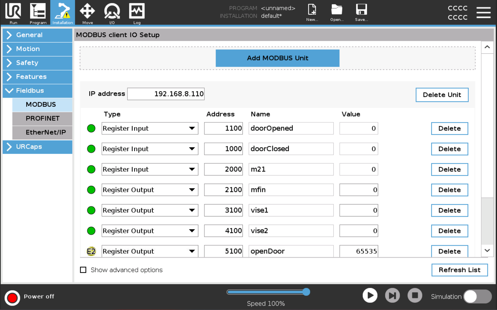

  

# DIO Tender

A URCap for Universal Robots e-Series that gives you a ready-made program skeleton for **machine tending** with a dual-gripper, dual-vise setup. You map your machine's signals once, then teach only the robot moves.

## Features

- **Ready-made cycle**: Pick Raw → Wait for M21 → Tend Swap (Unload, Load) → Place Finished, repeated forever.
- **Signal mapping**: connect the machine, vises and door to digital I/O or Modbus signals, with optional inversion.
- **Door and Vise nodes**: open or close the door (with feedback and timeout) or a vise (with a settle dwell).
- **Automatic handshake**: a short Cycle Complete pulse is never missed, and Cycle Start is pulsed once the robot is clear and the door is closed.

## Requirements

- Universal Robots e-Series.
- A machine, vises and door controllable through digital I/O or Modbus signals.

## Setup

### 1. Install the URCap

Copy the `.urcap` file to the robot and restart PolyScope, following the usual UR procedure for installing a URCap.

### 2. (Modbus only) Define your signals

Add any Modbus signals in **Installation > Fieldbus > MODBUS** first and give each a clear name. 0 means off, above 0 means on.

### 3. Map the seven signals

Open **Installation > URCaps > DIO Tender**, tick **Enable**, and choose an I/O for every signal.

| Signal | Direction | Purpose |
|--------|-----------|---------|
| Cycle Complete | machine → robot | Machine finished; robot may tend it |
| Door Opened | door → robot | Door fully open |
| Door Closed | door → robot | Door fully closed |
| Cycle Start | robot → machine | Pulse telling the machine to begin a cycle |
| Vise 1 | robot → vise | Open / close vise 1 |
| Vise 2 | robot → vise | Open / close vise 2 |
| Door Output | robot → door | Open / close the door |

Tick **Invert** if a signal's logic is reversed. The buttons next to each output let you test it immediately.

> [!NOTE]
> DIO Tender program nodes stay undefined until it is enabled and all seven signals are mapped.

## Using it in a program

1. In the **Program** tab, open **URCaps** and insert **DIO Tender**. It creates the template tree with comments describing what to teach at each step.
2. Teach your moves inside **Pick Raw**, **Unload (OP1)**, **Load (OP2)** and **Place Finished**.
3. Add **DIO Tender Door** and **DIO Tender Vise** nodes inside Unload and Load where needed.

### The cycle

| Node | What it does |
|------|--------------|
| **Pick Raw** | Your moves to pick a raw part from the infeed. |
| **Wait for M21** | Pauses until the machine signals Cycle Complete. |
| **Tend Swap** | Fixed container holding **Unload (OP1)** and **Load (OP2)**. When both finish, Cycle Start is pulsed. |
| **Place Finished** | Your moves to place the finished part at the outfeed. |

### Door node

Choose **Open** or **Close**. The node sets the Door Output, waits for the matching feedback, and stops with an error popup if the door doesn't respond within 10 seconds.

### Vise node

Choose the vise, **Open** or **Close**, and a **Dwell** time (default 1.0 s, max 60 s). Vises have no feedback signal, so the dwell lets them settle.

> [!IMPORTANT]
> Both grippers must be empty when the program starts.
